# 别重复造轮子 · dont-reinvent-the-wheel

[中文](README.zh-CN.md)

<p align="center">
  
</p>

An agent skill that finds what already exists before you build it — including when you
don't know what the existing thing is called.

## Why

"Search GitHub before you build" sounds simple and usually fails for one reason: the thing
exists under a name you didn't search for. While surveying prior art for this very skill, we
found the same idea published as `search-first`, `prior-art`, `idea-check`, `wheelspotter`,
`github-scout` and `skill-scout`. No single keyword finds them all.

dont-reinvent-the-wheel spends its effort where that problem lives:

1. **Name it six ways** before searching: the trade term, the user's words, another
   language, the category, a known product, and the first line a README would open with.
2. **Find one seed, then snowball**: read the seed's own "Alternatives" section, its topics
   and its awesome-list neighbours. Authors know their competition better than search does.
3. **Stop when the search goes quiet**: two rounds in a row that add nothing to the
   shortlist. A script keeps count, so "I searched enough" is a number.
4. **Leave a dated report** in `docs/prior-art/`, with the terms and sources used, so the
   next survey of the topic starts from this one.

It ends in one of four verdicts per part of the need: **Adopt, Extend, Compose, Build**.
Build requires completing the sentence "Existing X cannot do ___ because ___."

## Install

The skill is the folder `skills/dont-reinvent-the-wheel`. Copy it into your agent's skills directory:

```bash
git clone https://github.com/2233admin/dont-reinvent-the-wheel
cp -r dont-reinvent-the-wheel/skills/dont-reinvent-the-wheel ~/.claude/skills/        # Claude Code
```

Or with the `skills` CLI:

```bash
npx skills add 2233admin/dont-reinvent-the-wheel
```

It needs web search or shell network access. The bundled script needs Python 3.8+ and
nothing else.

## Use

Ask the way you normally would:

> Before we start — is there already something that does this?
>
> 我想做个从 AI 平台抓提示词和封面的素材库插件，先查查有没有现成的。

Or call the script directly:

```bash
S=.prior-art/link-checker.json
python3 skills/dont-reinvent-the-wheel/scripts/scout.py search --state $S \
  -t "markdown link checker" -t "dead link checker" -t "死链检查" --channels github,hn,npm
python3 skills/dont-reinvent-the-wheel/scripts/scout.py keep    --state $S lycheeverse/lychee
python3 skills/dont-reinvent-the-wheel/scripts/scout.py related --state $S lycheeverse/lychee
python3 skills/dont-reinvent-the-wheel/scripts/scout.py status  --state $S
```

`search` merges every term across every source and lists first whatever several terms agree
on. `related` lists the projects a seed's README names. `status` reports whether the search
has gone quiet. Stars and downloads are shown but never used for ranking. A source that fails
is reported as not searched, never as empty.

Set `GITHUB_TOKEN` to raise GitHub's search rate limit.

## Limits

- The stop rule depends on the agent marking what is worth keeping. The script counts; it
  does not judge relevance.
- PyPI has no search API. The `pypi` channel only checks whether a package is named after the
  term.
- Package registries are poor at concept queries. Use them for library-shaped needs.
- The skill has not yet been benchmarked against a no-skill baseline, and the `github`
  channel had not been exercised against the live API at the time of the first commit. See
  [the survey](docs/prior-art/dont-reinvent-the-wheel.md).

## Alternatives

This field is crowded, and several of these do things dont-reinvent-the-wheel does not. Details and
dates are in [docs/prior-art/dont-reinvent-the-wheel.md](docs/prior-art/dont-reinvent-the-wheel.md).

| Project | Use it instead when |
|---|---|
| [search-first](https://github.com/shimo4228/search-first) | You already know what to search for and need a rigorous adopt-or-build decision. Its verdict rules are stricter than ours. The two work well together: dont-reinvent-the-wheel to find, search-first to decide. |
| [prior-work-retrieval](https://github.com/daymade/claude-code-skills) | The question is "have *we* done this before?" — your own code, documents and past conversations. |
| [idea-reality-mcp](https://github.com/mnemox-ai/idea-reality-mcp) | You want a quick score for how crowded an idea is. Also usable as dont-reinvent-the-wheel's first pass. |
| [AutoSearch](https://github.com/0xmariowu/autosearch) | You need reach into many sources, including Chinese-language ones. A search backend that dont-reinvent-the-wheel can sit on top of. |
| [prior-art](https://github.com/bendrucker/claude) | You want a short manual command that summarises a few projects in chat. |

Not to be confused with [dont-reinvent](https://huggingface.co/datasets/LucioLiu/dont-reinvent), a
similarly named skill for finding existing *skills* before writing one.

## Development

```bash
python3 -m unittest discover -s tests
```

## Licence

MIT
